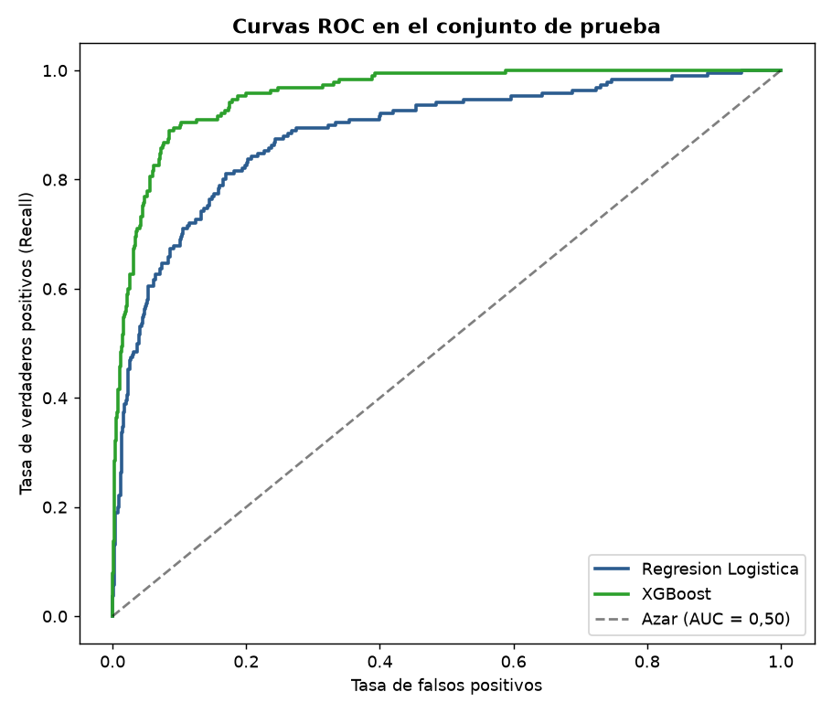
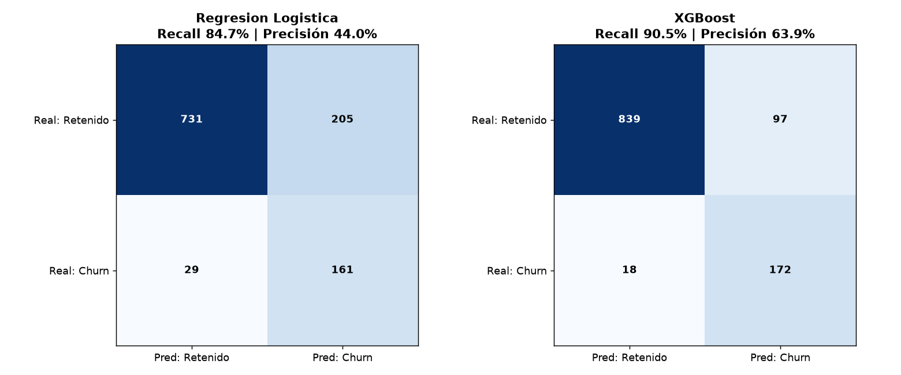
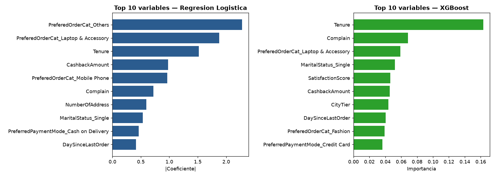
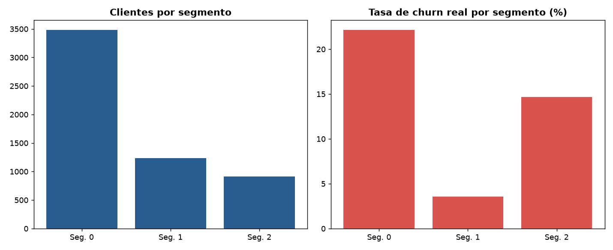

# Reporte de entrenamiento — Predicción de churn

Generado automáticamente por `python -m churn.train` el 2026-10-21 03:01 UTC.
Librerías: Python 3.13.7, scikit-learn 1.9.1, xgboost 3.4.1, pandas 3.0.6.

## 1. Datos

- Origen: `data/raw/ecommerce_data.csv` (archivo original, no se modifica), **5.630 clientes × 20 columnas**.
- Variable objetivo `Churn`: 948 clientes desertores (16.84 %) → clases **desbalanceadas**.
- IDs duplicados: 0.
- Valores nulos por columna: `DaySinceLastOrder` (307), `OrderAmountHikeFromlastYear` (265), `Tenure` (264), `OrderCount` (258), `CouponUsed` (256), `HourSpendOnApp` (255), `WarehouseToHome` (251).
- Limpieza de etiquetas duplicadas: `PreferredLoginDevice`: `Phone` → `Mobile Phone`; `PreferredPaymentMode`: `CC` → `Credit Card`, `COD` → `Cash on Delivery`; `PreferedOrderCat`: `Mobile` → `Mobile Phone`.

## 2. Preprocesamiento

1. Partición **80 % / 20 %** estratificada (`random_state=42`): 4.504 clientes de entrenamiento (16.83 % churn) y 1.126 de prueba (16.87 % churn).
2. Dentro de un `Pipeline` (ajustado **solo con entrenamiento**, sin *data leakage*):
   - Numéricas: imputación por **mediana** y, para la regresión logística, estandarización (`StandardScaler`).
   - Categóricas: **One-Hot Encoding** (categorías nuevas se ignoran al predecir).
3. `CustomerID` y `Churn` no entran como variables predictoras.

> A diferencia del notebook 01, la mediana se calcula **después** de separar entrenamiento y prueba, por lo que
> las métricas pueden diferir levemente de las del `README.md` (ver `notebooks/03_pipeline_reproducible.ipynb`).

## 3. Modelos

| Modelo | Hiperparámetros |
| --- | --- |
| Regresion Logistica | `{'class_weight': 'balanced', 'max_iter': 1000, 'random_state': 42}` |
| XGBoost | `{'n_estimators': 150, 'max_depth': 4, 'learning_rate': 0.05, 'random_state': 42, 'eval_metric': 'logloss', 'scale_pos_weight': 4.941952506596306}` |

- **Regresión Logística** (base): interpretable; `class_weight='balanced'` penaliza más no detectar a un desertor.
- **XGBoost** (avanzado): ensamble de árboles por gradiente que captura relaciones no lineales; `scale_pos_weight` = retenidos / desertores del entrenamiento.

## 4. Validación cruzada (solo sobre entrenamiento, 5 particiones estratificadas)

| Modelo | Recall | Precisión | F1 | ROC-AUC |
| --- | --- | --- | --- | --- |
| Regresion Logistica | 0.814 ± 0.048 | 0.464 ± 0.021 | 0.591 ± 0.024 | 0.890 ± 0.013 |
| XGBoost | 0.856 ± 0.044 | 0.649 ± 0.012 | 0.738 ± 0.023 | 0.947 ± 0.011 |

## 5. Resultados en prueba (N = 1.126)

| Modelo | Recall | Precisión | F1 | ROC-AUC | Accuracy | TP | FN | FP | TN |
| --- | --- | --- | --- | --- | --- | --- | --- | --- | --- |
| Regresion Logistica | 84.74 % | 43.99 % | 57.91 % | 88.51 % | 79.22 % | 161 | 29 | 205 | 731 |
| XGBoost ⭐ | 90.53 % | 63.94 % | 74.95 % | 95.65 % | 89.79 % | 172 | 18 | 97 | 839 |

**Modelo seleccionado: XGBoost** — criterio: mayor Recall medio en validación cruzada (desempate por ROC-AUC medio); el conjunto de prueba se reserva para el reporte final. Se prioriza el Recall porque no detectar a un cliente que se va cuesta más que enviar una promoción de más. Umbral de decisión: 0.5.




### Variables más influyentes

**Regresion Logistica**

| # | Variable | Peso |
| --- | --- | --- |
| 1 | `PreferedOrderCat_Others` | 2.2816 |
| 2 | `PreferedOrderCat_Laptop & Accessory` | 1.8763 |
| 3 | `Tenure` | 1.5208 |
| 4 | `CashbackAmount` | 0.9771 |
| 5 | `PreferedOrderCat_Mobile Phone` | 0.9667 |
| 6 | `Complain` | 0.7206 |
| 7 | `NumberOfAddress` | 0.5970 |
| 8 | `MaritalStatus_Single` | 0.5340 |
| 9 | `PreferredPaymentMode_Cash on Delivery` | 0.4604 |
| 10 | `DaySinceLastOrder` | 0.4153 |

**XGBoost**

| # | Variable | Peso |
| --- | --- | --- |
| 1 | `Tenure` | 0.1631 |
| 2 | `Complain` | 0.0685 |
| 3 | `PreferedOrderCat_Laptop & Accessory` | 0.0588 |
| 4 | `MaritalStatus_Single` | 0.0520 |
| 5 | `SatisfactionScore` | 0.0464 |
| 6 | `CashbackAmount` | 0.0458 |
| 7 | `CityTier` | 0.0438 |
| 8 | `DaySinceLastOrder` | 0.0406 |
| 9 | `PreferedOrderCat_Fashion` | 0.0391 |
| 10 | `PreferredPaymentMode_Credit Card` | 0.0366 |



## 6. Segmentación de clientes (K-Means, sin usar la etiqueta `Churn`)

Variables: `Tenure`, `DaySinceLastOrder`, `OrderCount`, `CashbackAmount` (imputación + estandarización). Se probó cada `k` de 3 a 6 (rango acotado a propósito: k = 2 solo separaría dos grandes grupos) y se eligió el de mayor coeficiente de silueta (k=3: 0.374, k=4: 0.333, k=5: 0.318, k=6: 0.330) → **k = 3**.

| Segmento | Clientes | Churn real | Perfil (vs promedio) |
| --- | --- | --- | --- |
| 0 | 3.480 | 22.13 % | antigüedad menor (-42%), días sin comprar menor (-32%), órdenes menor (-40%) |
| 1 | 1.236 | 3.56 % | antigüedad mayor (+105%), días sin comprar mayor (+21%), órdenes menor (-23%), cashback mayor (+28%) |
| 2 | 914 | 14.66 % | antigüedad mayor (+17%), días sin comprar mayor (+94%), órdenes mayor (+183%) |



## 7. Cómo reproducirlo

```bash
pip install -r requirements.txt && pip install -e .
python -m churn.train                      # entrena, evalúa y regenera modelos, reportes y datasets
python -m churn.predict --input data/raw/ecommerce_data.csv --output predicciones.csv
pytest --cov=src --cov-report=term-missing
```

## 8. Archivos generados

| Archivo | Contenido |
| --- | --- |
| `models/churn_model.joblib` | Pipeline completo (preprocesamiento + modelo seleccionado) |
| `models/segmenter.joblib` | Pipeline de segmentación K-Means |
| `models/model_card.json` | Ficha del modelo: hiperparámetros, versiones, métricas |
| `reports/metrics.json` | Todas las métricas (prueba y validación cruzada) |
| `data/processed/test_predictions.csv` | Probabilidades de cada modelo sobre el conjunto de prueba |
| `data/processed/customer_segments.csv` | Segmento asignado a cada cliente |

## 9. Limitaciones

- Una sola partición de prueba; la validación cruzada solo se calcula sobre entrenamiento.
- Umbral fijo de 0.5; las bandas de riesgo (Bajo/Medio/Alto) son heurísticas, no probabilidades calibradas.
- El modelo guardado se entrena con el 80 % de los clientes y se evalúa con el 20 % restante; el segmentador usa el 100 % porque no depende de la etiqueta.
- Dataset piloto de 5.630 clientes: validar con datos reales antes de usarlo en producción.
